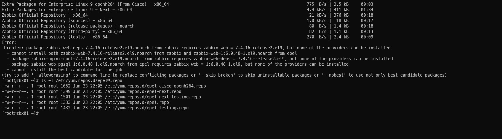

when installing zabbix i got the below error



the reason is because, The conflict happens because:
- Zabbix 7.4 requires zabbix-web version 7.4.16.
- EPEL is offering zabbix-web-pgsql version 6.0.48.
- The EPEL package requires zabbix-web version 6.0.48.
- DNF cannot install both versions simultaneously.

solution
--

Disable Zabbix packages provided by EPEL, if you have it installed. Edit file /etc/yum.repos.d/epel.repo and add the following statement.

```bash
[epel]
...
excludepkgs=zabbix*
```


