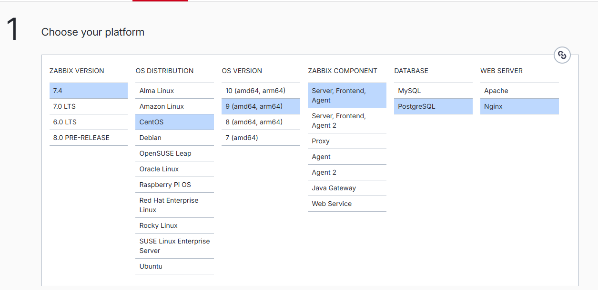
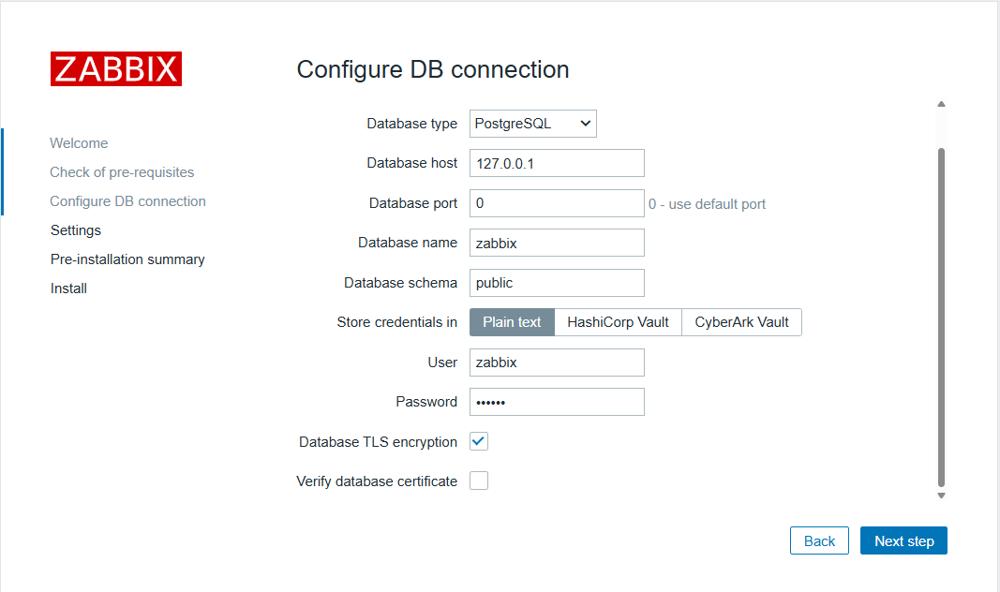
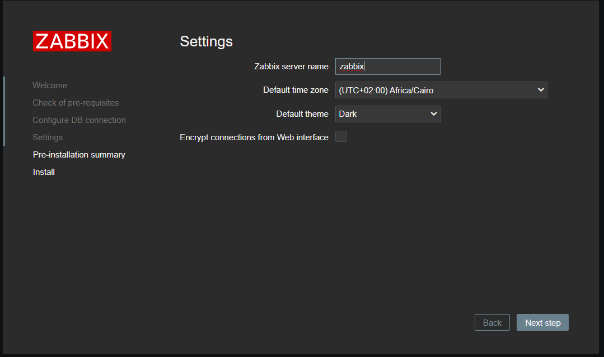
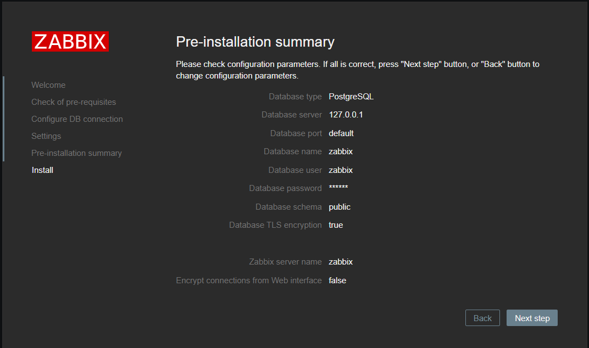
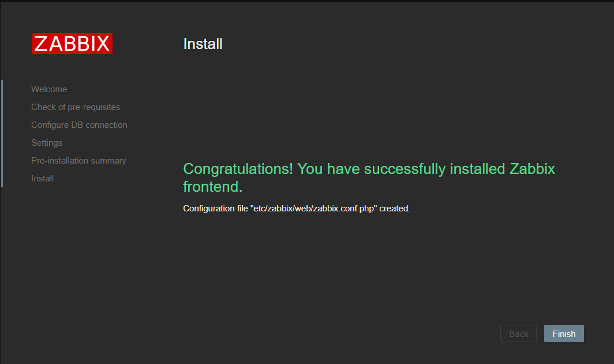
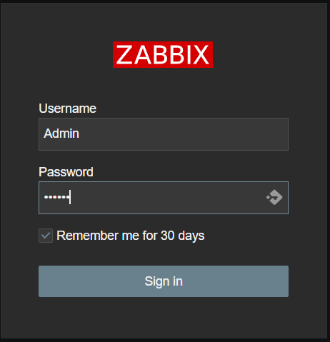
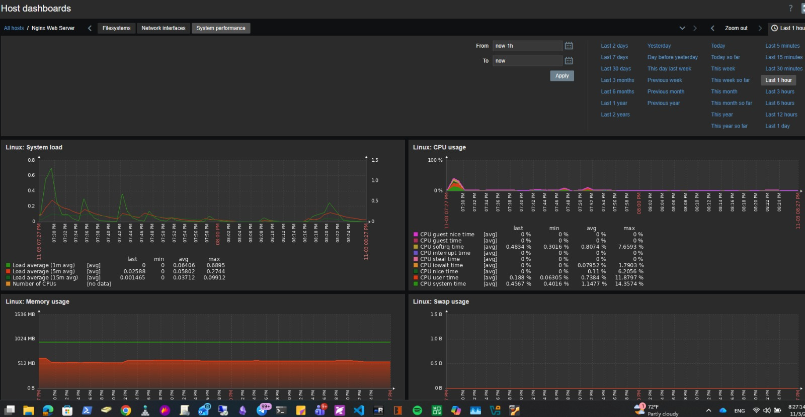

# Infrastructure Monitoring – Zabbix & Nagios

This section documents the installation and configuration of two infrastructure monitoring solutions: **Zabbix** and **Nagios Core** on CentOS Stream 9.

---

# 1. Zabbix

## 1.1 Installation Guide

Follow the official Zabbix installation instructions using the link below:

[Zabbix 7.4 – CentOS 9 – PostgreSQL – Nginx](https://www.zabbix.com/download?zabbix=7.4&os_distribution=centos&os_version=9&components=server_frontend_agent&db=pgsql&ws=nginx)



## 1.2 Install PostgreSQL

**Important:** Before initializing the Zabbix database (Step C in the official installation guide), make sure the required PostgreSQL version is installed and running.

Install PostgreSQL 16:

```bash
dnf module install postgresql:16/server
```

Initialize the database:

```bash
postgresql-setup --initdb
```

Enable and start PostgreSQL:

```bash
systemctl enable --now postgresql
```

## 1.3 PostgreSQL Authentication Troubleshooting

During the installation, I encountered an issue because I didn't know the password assigned to the PostgreSQL `zabbix` user.

### Step 1: Reset the Zabbix Database User Password

Switch to the PostgreSQL operating system account:

```bash
sudo -i -u postgres
```

Open the PostgreSQL command-line interface:

```sql
psql
```

Reset the password:

```sql
ALTER USER zabbix WITH PASSWORD 'zabbix';
```

Exit PostgreSQL:

```sql
\q
```

### Step 2: Test the Database Connection

Test the connection using the following command:

```bash
psql -h 127.0.0.1 -p 5432 -U zabbix -d zabbix -W
```

However, I received the following error:

```text
Password:

psql: error: connection to server at "127.0.0.1",
port 5432 failed: FATAL: Ident authentication failed
for user "zabbix"
```

### Step 3: Understand the Authentication Error

This error means that PostgreSQL is using **Ident authentication** for TCP connections instead of password-based authentication.

PostgreSQL is trying to authenticate the operating-system identity associated with the connection rather than validating the password entered by the user.

### Step 4: Locate the Active PostgreSQL Authentication File

Connect to PostgreSQL and execute:

```bash
psql -c "SHOW hba_file;"
```

Example output:

```text
                 hba_file
-----------------------------------------
 /var/lib/pgsql/data/pg_hba.conf
(1 row)
```

### Step 5: Inspect the Authentication Rules

Execute:

```bash
grep -nEv '^[[:space:]]*(#|$)' \
/var/lib/pgsql/data/pg_hba.conf
```

Example output:

```text
113:local   all             all                         peer
115:host    all             all     127.0.0.1/32        ident
117:host    all             all     ::1/128             ident
120:local   replication     all                         peer
121:host    replication     all     127.0.0.1/32        ident
122:host    replication     all     ::1/128             ident
```

The `ident` authentication method is responsible for the connection failure.

### Step 6: Change Authentication to SCRAM-SHA-256

Edit the PostgreSQL authentication configuration:

```bash
vim /var/lib/pgsql/data/pg_hba.conf
```

Add the following rule before any general rule matching the same connection:

```text
host    zabbix    zabbix    127.0.0.1/32    scram-sha-256
```

This rule tells PostgreSQL to authenticate connections from the `zabbix` user to the `zabbix` database using password-based SCRAM-SHA-256 authentication.

### Step 7: Reload PostgreSQL

Apply the configuration changes:

```bash
sudo systemctl reload postgresql
```

### Step 8: Test Database Authentication Again

Execute:

```bash
psql -h 127.0.0.1 -p 5432 -U zabbix -d zabbix -W
```

Expected output:

```text
Password:
psql (16.8)
Type "help" for help.

zabbix=> SELECT current_user, current_database();

 current_user | current_database
--------------+------------------
 zabbix       | zabbix
(1 row)

zabbix=>
```

<ins>Result:</ins> PostgreSQL password authentication is now working successfully.

## 1.4 Continue Zabbix Installation

After resolving the PostgreSQL authentication issue, continue following the remaining steps in the official Zabbix installation guide.









## 1.5 Zabbix Web Interface

After completing the installation, access the Zabbix web interface through your browser.

Default login credentials:

| Parameter | Value |
|---|---|
| Username | `Admin` |
| Password | `zabbix` |



**Security Note:** Change the default administrator password immediately after the first login.

## Install Zabbix Agent on End Devices

Download and install Zabbix repository

`wget https://repo.zabbix.com/zabbix/7.4/release/ubuntu/pool/main/z/zabbix-release/zabbix-release_latest_7.4+ubuntu22.04_all.deb`

install

`sudo dpkg -i zabbix-release_latest_7.4+ubuntu22.04_all.deb`

Update package information:

`sudo apt update`

Verify the available Agent 2 version:

`apt-cache policy zabbix-agent2`

install agent 2

`sudo apt install zabbix-agent2 -y`

Verify:

`zabbix_agent2 --version`

Configure the agent

sudo vim /etc/zabbix/zabbix_agent2.conf

```bash

Server=192.168.56.16
ServerActive=192.168.56.16
Hostname=web01

ListenPort=10050
ListenIP=0.0.0.0

LogFile=/var/log/zabbix/zabbix_agent2.log
LogFileSize=10
```

Start the service

```bash
sudo systemctl enable --now zabbix-agent2
sudo systemctl status zabbix-agent2
```

Verify monitoring

```bash
sudo ss -tulpn | grep 10050
zabbix_agent2 -t agent.ping
zabbix_agent2 -t system.cpu.load
zabbix_agent2 -t vm.memory.size[total]
```


## Register Endpoint in Zabbix Server

**Validate Configuration First**

`sudo grep -E '^(Server|ServerActive|Hostname|ListenPort|ListenIP)=' /etc/zabbix/zabbix_agent2.conf`

**Verify connectivity between Ubuntu and Zabbix Server**

`nc -zv Zabbix_Server 10051`

i got error here, which i found that the zabbix port not running on zabbix server itself

**Check zabbix service log**
`sudo tail -n 100 /var/log/zabbix/zabbix_server.log`

i found the below error

```bash
  6811:20261103:162702.988 database is down: reconnecting in 10 seconds
  6811:20261103:162713.008 [Z3001] connection to database 'zabbix' failed: [0] FATAL:  Ident authentication failed for user "zabbix"
```

**Check the Status of Postgres service**

**make sure that the /var/lib/pgsql/data/pg_hba.conf is configured as we did**

**make sure the database parameters is correct in /etc/zabbix/zabbix_server.conf**

then restart both postgress and zabbix

i got another issue while trying adding host from the zabbix dashboard

`Cannot inherit item with key "system.sw\.os" of template "Linux by Zabbix agent" to host "web01", because a host interface of type "Agent" is required.`

the meaning of this error because i trying to use ready template of metrices while this template contain passive agent item which require to add the host with interface IP to communicate with it

**Important: Passive vs. active checks**

- Linux by Zabbix agent: Uses passive checks. The Zabbix server connects to Client:10050.
- Linux by Zabbix agent active: Uses active checks. The agent connects to Zabbix:10051.

**What is the difference between zabbix agent 1 and zabbix agent 2**

- zabbix agent 2 is the newer version of zabbix agent 1
- zabbix agent 2 written in Go langauage while zabbix agent 1 written in C
- zabbix agent 2 is plugin based, which mean each system need monitor has a plugin
---

**Verify Endpoint on Zabbix Dashboard**

