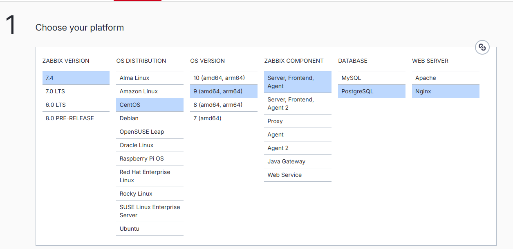
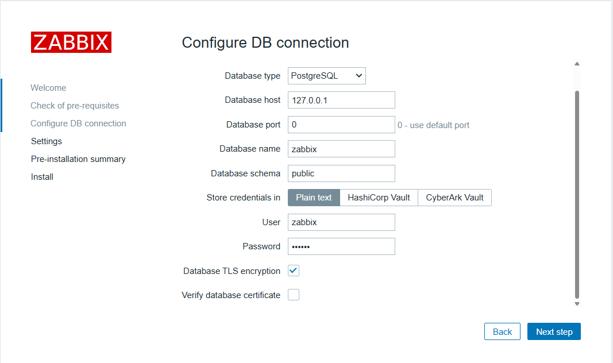
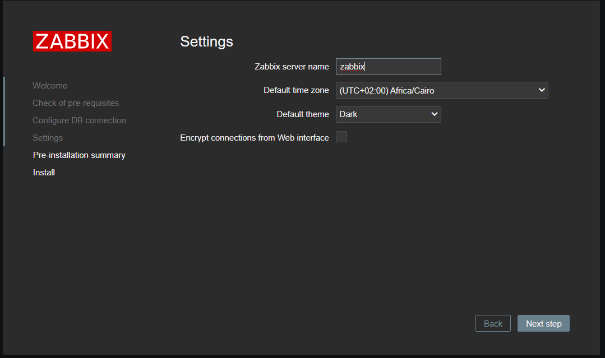
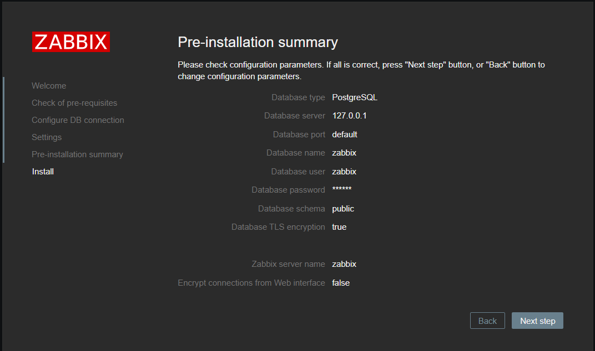
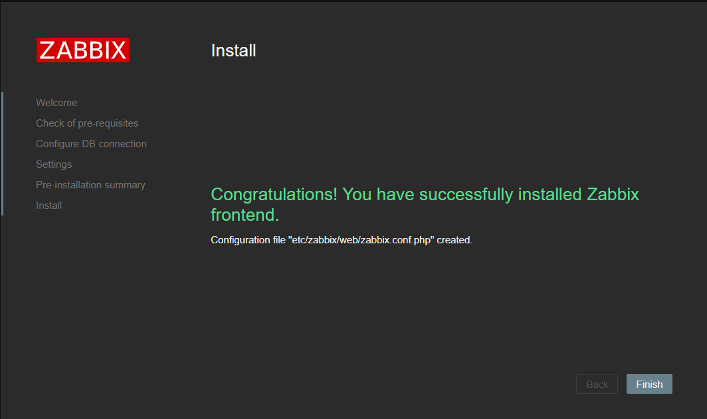
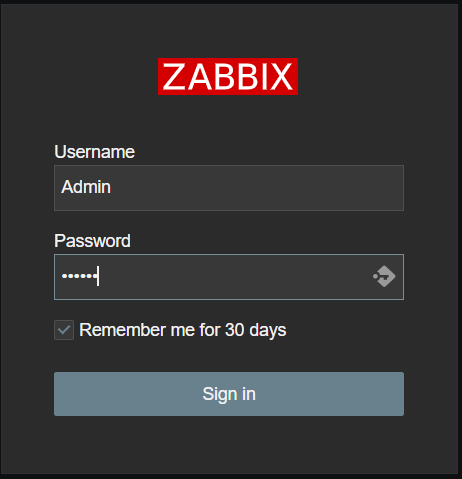

# Infrastructure Monitoring – Zabbix & Nagios

This section documents the installation and configuration of two infrastructure monitoring solutions: **Zabbix** and **Nagios Core** on CentOS Stream 9.

---

# 1. Zabbix

## 1.1 Installation Guide

Follow the official Zabbix installation instructions using the link below:

[Zabbix 7.4 – CentOS 9 – PostgreSQL – Nginx](https://www.zabbix.com/download?zabbix=7.4&os_distribution=centos&os_version=9&components=server_frontend_agent&db=pgsql&ws=nginx)



## 1.2 Install PostgreSQL

**Important:** Before initializing the Zabbix database (Step C in the official installation guide), make sure the required PostgreSQL version is installed and running.

Install PostgreSQL 16:

```bash
dnf module install postgresql:16/server
```

Initialize the database:

```bash
postgresql-setup --initdb
```

Enable and start PostgreSQL:

```bash
systemctl enable --now postgresql
```

## 1.3 PostgreSQL Authentication Troubleshooting

During the installation, I encountered an issue because I didn't know the password assigned to the PostgreSQL `zabbix` user.

### Step 1: Reset the Zabbix Database User Password

Switch to the PostgreSQL operating system account:

```bash
sudo -i -u postgres
```

Open the PostgreSQL command-line interface:

```sql
psql
```

Reset the password:

```sql
ALTER USER zabbix WITH PASSWORD 'zabbix';
```

Exit PostgreSQL:

```sql
\q
```

### Step 2: Test the Database Connection

Test the connection using the following command:

```bash
psql -h 127.0.0.1 -p 5432 -U zabbix -d zabbix -W
```

However, I received the following error:

```text
Password:

psql: error: connection to server at "127.0.0.1",
port 5432 failed: FATAL: Ident authentication failed
for user "zabbix"
```

### Step 3: Understand the Authentication Error

This error means that PostgreSQL is using **Ident authentication** for TCP connections instead of password-based authentication.

PostgreSQL is trying to authenticate the operating-system identity associated with the connection rather than validating the password entered by the user.

### Step 4: Locate the Active PostgreSQL Authentication File

Connect to PostgreSQL and execute:

```bash
psql -c "SHOW hba_file;"
```

Example output:

```text
                 hba_file
-----------------------------------------
 /var/lib/pgsql/data/pg_hba.conf
(1 row)
```

### Step 5: Inspect the Authentication Rules

Execute:

```bash
grep -nEv '^[[:space:]]*(#|$)' \
/var/lib/pgsql/data/pg_hba.conf
```

Example output:

```text
113:local   all             all                         peer
115:host    all             all     127.0.0.1/32        ident
117:host    all             all     ::1/128             ident
120:local   replication     all                         peer
121:host    replication     all     127.0.0.1/32        ident
122:host    replication     all     ::1/128             ident
```

The `ident` authentication method is responsible for the connection failure.

### Step 6: Change Authentication to SCRAM-SHA-256

Edit the PostgreSQL authentication configuration:

```bash
vim /var/lib/pgsql/data/pg_hba.conf
```

Add the following rule before any general rule matching the same connection:

```text
host    zabbix    zabbix    127.0.0.1/32    scram-sha-256
```

This rule tells PostgreSQL to authenticate connections from the `zabbix` user to the `zabbix` database using password-based SCRAM-SHA-256 authentication.

### Step 7: Reload PostgreSQL

Apply the configuration changes:

```bash
sudo systemctl reload postgresql
```

### Step 8: Test Database Authentication Again

Execute:

```bash
psql -h 127.0.0.1 -p 5432 -U zabbix -d zabbix -W
```

Expected output:

```text
Password:
psql (16.8)
Type "help" for help.

zabbix=> SELECT current_user, current_database();

 current_user | current_database
--------------+------------------
 zabbix       | zabbix
(1 row)

zabbix=>
```

<ins>Result:</ins> PostgreSQL password authentication is now working successfully.

## 1.4 Continue Zabbix Installation

After resolving the PostgreSQL authentication issue, continue following the remaining steps in the official Zabbix installation guide.









## 1.5 Zabbix Web Interface

After completing the installation, access the Zabbix web interface through your browser.

Default login credentials:

| Parameter | Value |
|---|---|
| Username | `Admin` |
| Password | `zabbix` |



**Security Note:** Change the default administrator password immediately after the first login.

## Install Zabbix Agent on End Devices

Download and install Zabbix repository

`wget https://repo.zabbix.com/zabbix/7.4/release/ubuntu/pool/main/z/zabbix-release/zabbix-release_latest_7.4+ubuntu22.04_all.deb`

install

`sudo dpkg -i zabbix-release_latest_7.4+ubuntu22.04_all.deb`

Update package information:

`sudo apt update`

Verify the available Agent 2 version:

`apt-cache policy zabbix-agent2`

install agent 2

`sudo apt install zabbix-agent2 -y`

Verify:

`zabbix_agent2 --version`

Configure the agent

sudo vim /etc/zabbix/zabbix_agent2.conf

```bash

Server=ZABBIX_SERVER_IP
ServerActive=ZABBIX_SERVER_IP
Hostname=web01

ListenPort=10050
ListenIP=0.0.0.0

LogFile=/var/log/zabbix/zabbix_agent2.log
LogFileSize=10
```

Start the service

```bash
sudo systemctl enable --now zabbix-agent2
sudo systemctl status zabbix-agent2
```

Verify monitoring

```bash
sudo ss -tulpn | grep 10050
zabbix_agent2 -t agent.ping
zabbix_agent2 -t system.cpu.load
zabbix_agent2 -t vm.memory.size[total]
```


## Register Endpoint in Zabbix Server

**Validate Configuration First**

`sudo grep -E '^(Server|ServerActive|Hostname|ListenPort|ListenIP)=' /etc/zabbix/zabbix_agent2.conf`

**Verify connectivity between Ubuntu and Zabbix Server**

`nc -zv Zabbix_Server 10051`

i got error here, which i found that the zabbix port not running on zabbix server itself

**Check zabbix service log**
`sudo tail -n 100 /var/log/zabbix/zabbix_server.log`

i found the below error

```bash
  6811:20261103:162702.988 database is down: reconnecting in 10 seconds
  6811:20261103:162713.008 [Z3001] connection to database 'zabbix' failed: [0] FATAL:  Ident authentication failed for user "zabbix"
```

**Check the Status of Postgres service**

**make sure that the /var/lib/pgsql/data/pg_hba.conf is configured as we did**

**make sure the database parameters is correct in /etc/zabbix/zabbix_server.conf**

then restart both postgress and zabbix

i got another issue while trying adding host from the zabbix dashboard

`Cannot inherit item with key "system.sw\.os" of template "Linux by Zabbix agent" to host "web01", because a host interface of type "Agent" is required.`

the meaning of this error because i trying to use ready template of metrices while this template contain passive agent item which require to add the host with interface IP to communicate with it

**Important: Passive vs. active checks**

- Linux by Zabbix agent: Uses passive checks. The Zabbix server connects to Client:10050.
- Linux by Zabbix agent active: Uses active checks. The agent connects to Zabbix:10051.

**What is the difference between zabbix agent 1 and zabbix agent 2**

- zabbix agent 2 is the newer version of zabbix agent 1
- zabbix agent 2 written in Go langauage while zabbix agent 1 written in C
- zabbix agent 2 is plugin based, which mean each system need monitor has a plugin
---

# 2. Nagios

## 2.1 Introduction

Nagios is an infrastructure monitoring solution used to monitor servers, network devices, applications, and services.

Nagios monitoring consists of three main components:

| Component | Description |
|---|---|
| **Nagios Core** | The central monitoring engine responsible for scheduling checks, processing results, and generating alerts. |
| **Nagios Plugins** | Executable programs that perform actual monitoring checks and return results to Nagios Core. |
| **Nagios Cross-Platform Agent (NCPA)** | An agent that collects monitoring information from remote servers and exposes it through an API. |

## 2.2 Nagios Core

Nagios Core is the main monitoring application installed on the central monitoring server.

Its responsibilities include:

- Monitoring hosts and services.
- Scheduling monitoring checks.
- Processing check results.
- Detecting Warning and Critical states.
- Generating alerts and notifications.
- Providing the web interface.
- Managing monitoring configurations.

## 2.3 Nagios Plugins

Nagios Plugins are executable programs that perform specific monitoring operations and return their results to Nagios Core.

For example, when monitoring disk utilization, Nagios Core does not calculate disk usage itself. Instead, it executes a plugin called `check_disk`.

### Common Nagios Plugins

| Plugin | Function |
|---|---|
| `check_ping` | Checks network connectivity. |
| `check_http` | Checks HTTP/HTTPS availability. |
| `check_disk` | Monitors disk utilization. |
| `check_load` | Monitors Linux system load. |
| `check_users` | Monitors logged-in users. |
| `check_procs` | Monitors running processes. |
| `check_tcp` | Checks TCP port availability. |
| `check_snmp` | Monitors SNMP-enabled devices. |

## 2.4 Nagios Cross-Platform Agent (NCPA)

NCPA is a monitoring agent developed by Nagios Enterprises. It allows Nagios Core to collect monitoring information from remote operating systems.

### Supported Operating Systems

- Linux (CentOS, RHEL, Ubuntu, etc.).
- Windows Server.
- macOS.
- Other supported Unix-like platforms.

### Monitoring Capabilities

| Metric | What You Can Monitor |
|---|---|
| CPU | CPU utilization. |
| Memory | RAM utilization. |
| Disk | Disk usage and available space. |
| Network | Network interfaces and traffic. |
| Processes | Running processes. |
| Services | Operating system services. |
| System | OS information and uptime. |

### How Does NCPA Communicate with Nagios?

NCPA provides an API, normally accessible over HTTPS using TCP port `5693`.

Nagios Core communicates with the NCPA API to retrieve monitoring information from remote systems.

---

# 3. Nagios Core Installation on CentOS 9

## 3.1 Prepare the Operating System

### Disable SELinux

For this lab installation, disable SELinux:

```bash
sed -i 's/SELINUX=.*/SELINUX=disabled/g' /etc/selinux/config
setenforce 0
```

> **Note:** Disabling SELinux is suitable for a temporary lab environment. In production, configure the required SELinux policies instead.

### Install Required Dependencies

```bash
dnf install -y gcc glibc glibc-common perl httpd php wget gd gd-devel s-nail postfix

dnf install -y openssl-devel
```

Update the operating system:

```bash
dnf update -y
```

## 3.2 Download Nagios Core

Navigate to the temporary directory:

```bash
cd /tmp
```

Download the latest Nagios Core release automatically from GitHub:

```bash
wget --output-document="nagioscore.tar.gz" \
$(wget -q -O - https://api.github.com/repos/NagiosEnterprises/nagioscore/releases/latest \
| grep '"browser_download_url":' \
| grep -o 'https://[^"]*')
```

Extract the downloaded archive:

```bash
tar xzf nagioscore.tar.gz
```

Navigate to the extracted directory:

```bash
cd /tmp/nagios-*/
```

## 3.3 Compile and Install Nagios Core

Configure the installation:

```bash
./configure
```

Compile the source code:

```bash
make all
```

Create the required Nagios groups and users:

```bash
make install-groups-users
```

Add Apache to the Nagios group:

```bash
usermod -a -G nagios apache
```

Install Nagios Core:

```bash
make install
```

Install the systemd service:

```bash
make install-daemoninit
```

Enable Apache:

```bash
systemctl enable httpd.service
```

Configure command permissions:

```bash
make install-commandmode
```

Install sample configuration files:

```bash
make install-config
```

Install the Apache web configuration:

```bash
make install-webconf
```

## 3.4 Configure Firewall

Allow HTTP traffic through the firewall:

```bash
firewall-cmd --zone=public --add-port=80/tcp
```

Make the firewall rule permanent:

```bash
firewall-cmd --zone=public --add-port=80/tcp --permanent
```

Reload firewall configuration:

```bash
firewall-cmd --reload
```

## 3.5 Create Nagios Web Authentication

Create the Nagios administrator account:

```bash
htpasswd -c /usr/local/nagios/etc/htpasswd.users nagiosadmin
```

Enter and confirm the password when prompted.

> **Note:** The `-c` option creates a new password file. Do not use it when adding additional users to an existing file, as it overwrites the file.

## 3.6 Start Nagios and Apache Services

Start Apache:

```bash
systemctl start httpd.service
```

Start Nagios:

```bash
systemctl start nagios.service
```

Verify both services:

```bash
systemctl status httpd.service
systemctl status nagios.service
```

## 3.7 Access Nagios Web Interface

Open your browser and navigate to the Nagios server IP address or FQDN.

Example:

```text
http://10.25.5.143/nagios
```

You will be prompted for authentication.

| Parameter | Value |
|---|---|
| Username | `nagiosadmin` |
| Password | The password created using `htpasswd` which is `Nagios`. |

---

# 4. Installing Nagios Plugins

Nagios Core requires plugins to execute monitoring checks.

Without Nagios Plugins, the monitoring engine cannot perform the standard checks required to monitor hosts and services.

## 4.1 Install Plugin Dependencies

```bash
dnf install -y gcc glibc glibc-common make gettext automake autoconf wget openssl-devel net-snmp net-snmp-utils epel-release
```

Enable the CRB repository:

```bash
dnf config-manager --set-enabled crb
```

Install the Perl SNMP module:

```bash
dnf install -y perl-Net-SNMP
```

## 4.2 Download Nagios Plugins

Navigate to the temporary directory:

```bash
cd /tmp
```

Download the latest Nagios Plugins release from GitHub:

```bash
wget --output-document="nagios-plugins.tar.gz" \
$(wget -q -O - https://api.github.com/repos/nagios-plugins/nagios-plugins/releases/latest \
| grep '"browser_download_url":' \
| grep -o 'https://[^"]*')
```

Extract the archive:

```bash
tar zxf nagios-plugins.tar.gz
```

Navigate to the extracted directory:

```bash
cd /tmp/nagios-plugins-*/
```

## 4.3 Compile and Install Nagios Plugins

Configure the installation:

```bash
./configure
```

Compile:

```bash
make
```

Install:

```bash
make install
```

## 4.4 Plugin Installation Location

After successful installation, the plugins will be located in:

```text
/usr/local/nagios/libexec/
```

You can verify the installed plugins:

```bash
ls -lh /usr/local/nagios/libexec/
```

---

# 5. Testing Nagios Plugins

After installing Nagios Plugins, access the Nagios web interface:

```text
http://10.25.5.143/nagios
```

Alternatively:

```text
http://core-013.domain.local/nagios
```

Navigate to a host or service object and select:

**Commands → Re-schedule the next check**

This forces Nagios to execute the monitoring check again.

If the plugins are installed correctly and the configuration is valid, the previous plugin-related error should disappear and the correct monitoring output should be displayed.

---

# 6. Nagios Service Management

Use the following commands to manage the Nagios service.

### Start Nagios

```bash
systemctl start nagios.service
```

### Stop Nagios

```bash
systemctl stop nagios.service
```

### Restart Nagios

```bash
systemctl restart nagios.service
```

### Check Nagios Service Status

```bash
systemctl status nagios.service
```

### Enable Nagios at System Startup

```bash
systemctl enable nagios.service
```

### Disable Nagios at System Startup

```bash
systemctl disable nagios.service
```

Download and install NCPA
First, update Ubuntu:

```bash
sudo apt update
sudo apt upgrade -y
sudo apt install -y wget curl
```
Recommended method: Install using the Nagios repository
I recommend this method because future updates can be managed through apt.

```bash
# Add Nagios repository
echo "deb https://repo.nagios.com/deb/$(lsb_release -cs) /" \
  | sudo tee /etc/apt/sources.list.d/nagios.list

# Install repository signing key
sudo apt install -y curl gnupg

curl -fsSL https://repo.nagios.com/GPG-KEY-NAGIOS-V3 \
  | sudo gpg --dearmor -o /usr/share/keyrings/nagios-archive-keyring.gpg
```
Configure the repository to use the key:

```bash
echo "deb [signed-by=/usr/share/keyrings/nagios-archive-keyring.gpg] https://repo.nagios.com/deb/$(lsb_release -cs) /" \
  | sudo tee /etc/apt/sources.list.d/nagios.list
```

Install NCPA:

```bash
sudo apt update
sudo apt install -y ncpa
```

Configure NCPA

```bash
sudo vim /usr/local/ncpa/etc/ncpa.cfg
```
Find the [api] section:

```bash
[api]
community_string = mytoken
```
Change the default token to a strong password, for example:

```bash
[api]
community_string = Nagios100@@100n
```

Start and enable NCPA

```bash
sudo systemctl list-units --type=service | grep ncpa
```

Restart the Service

```bash
sudo systemctl restart ncpa
sudo systemctl enable ncpa
sudo ss -lntp | grep 5693
```

You should see NCPA listening on TCP port 5693.

Test the NCPA API locally

`curl -k "https://127.0.0.1:5693/api?token=Nagios100@@100n"`

Access NCPA Web Interface

`https://UBUNTU_SERVER_IP:5693`


### Integrating Client to Nagios Core

Note: to integrate nagios core with hosts you need python script to install NCPA plugin on nagios core, nagios use this plugin to communicate with NCPA API.

let's install it

```bash
cd /tmp
wget https://assets.nagios.com/downloads/ncpa/check_ncpa.tar.gz
tar -xzf check_ncpa.tar.gz
```

Copy the plugin into the Nagios plugins directory:

```bash
sudo cp check_ncpa.py /usr/local/nagios/libexec/
sudo chown nagios:nagios /usr/local/nagios/libexec/check_ncpa.py
sudo chmod 755 /usr/local/nagios/libexec/check_ncpa.py
```

verify installation

`/usr/local/nagios/libexec/check_ncpa.py -V`

Configure the NCPA API token

on the host machine ( ubuntu web01)

`sudo vim /usr/local/ncpa/etc/ncpa.cfg`

Replace mytoken with your own secure token as we done before

Now test the NCPA plugin from nagios core server:

```bash
/usr/local/nagios/libexec/check_ncpa.py \
-H web01 \
-t 'Nagios100@@100n' \
-P 5693 \
-M system/agent_version
```

Expected output:

`OK: Agent_version was ['3.x.x']`

Step 4. Create the Nagios command definition
Nagios needs a command definition that tells it how to execute the NCPA plugin.

Open:
`sudo vim /usr/local/nagios/etc/objects/commands.cfg`

Add:

```bash

define command {
    command_name    check_ncpa
    command_line    $USER1$/check_ncpa.py -H $HOSTADDRESS$ $ARG1$ }
```

Step 5. Store the API token securely
Rather than writing your API token directly into the host configuration, store it as a Nagios resource macro.

Open:

`sudo vim /usr/local/nagios/etc/resource.cfg`

Add:

`$USER5$=Nagios100@@100n`

Restrict access:

```bash
sudo chown nagios:nagios /usr/local/nagios/etc/resource.cfg
sudo chmod 640 /usr/local/nagios/etc/resource.cfg
```

Step 6. Create the Ubuntu host configuration
Create a separate configuration file for web01:

`sudo vim /usr/local/nagios/etc/objects/web01.cfg`

```bash


###############################################################################
# Ubuntu 22.04 - web01
# Monitoring through Nagios Cross-Platform Agent (NCPA)
###############################################################################

define host {
    use                     linux-server
    host_name               web01
    alias                   Ubuntu 22.04 Web Server
    address                 192.168.56.15
    check_period            24x7
    check_interval          5
    retry_interval          1
    max_check_attempts      5
    notification_interval   30
    notification_period     24x7
}

###############################################################################
# NCPA Agent Version
###############################################################################

define service {
    use                     generic-service
    host_name               web01
    service_description     NCPA Agent Version
    check_command           check_ncpa!-t '$USER5$' -P 5693 -M system/agent_version
}

###############################################################################
# CPU Usage
###############################################################################

define service {
    use                     generic-service
    host_name               web01
    service_description     CPU Usage
    check_command           check_ncpa!-t '$USER5$' -P 5693 -M cpu/percent -q aggregate=avg -w 80 -c 90
}

###############################################################################
# Memory Usage
###############################################################################

define service {
    use                     generic-service
    host_name               web01
    service_description     Memory Usage
    check_command           check_ncpa!-t '$USER5$' -P 5693 -M memory/virtual/percent -w 80 -c 90
}

###############################################################################
# Disk Usage - Root Partition
###############################################################################

define service {
    use                     generic-service
    host_name               web01
    service_description     Root Disk Usage
    check_command           check_ncpa!-t '$USER5$' -P 5693 -M 'disk/logical/|/used_percent' -w 80 -c 90
}

###############################################################################
# Process Count
###############################################################################

define service {
    use                     generic-service
    host_name               web01
    service_description     Process Count
    check_command           check_ncpa!-t '$USER5$' -P 5693 -M processes -w 300 -c 400
}

###############################################################################
# System Uptime
###############################################################################

define service {
    use                     generic-service
    host_name               web01
    service_description     System Uptime
    check_command           check_ncpa!-t '$USER5$' -P 5693 -M system/uptime
}

```

Step 7. Register the configuration file
Nagios must know where your new host configuration file is located.

Open:

`sudo vim /usr/local/nagios/etc/nagios.cfg`

Add:

`cfg_file=/usr/local/nagios/etc/objects/web01.cfg`

Validate the Nagios configuration

```bash
sudo /usr/local/nagios/bin/nagios \
-v /usr/local/nagios/etc/nagios.cfg
```

Restart Nagios Core

Verify monitoring through Nagios Web UI

`http://nag01/nagios/`

---

# 7. Useful References

| Resource | Link |
|---|---|
| Zabbix Official Documentation | [Zabbix Documentation](https://www.zabbix.com/documentation/current/en/manual) |
| Zabbix Download Page | [Zabbix Download](https://www.zabbix.com/download) |
| Nagios Core Documentation | [Nagios Documentation](https://www.nagios.org/documentation/) |
| Nagios Core GitHub | [Nagios Core Repository](https://github.com/NagiosEnterprises/nagioscore) |
| Nagios Plugins GitHub | [Nagios Plugins Repository](https://github.com/nagios-plugins/nagios-plugins) |
| NCPA Documentation | [NCPA Documentation](https://www.nagios.org/ncpa/) |

---

**Lab Status:** Zabbix and Nagios Core installation and initial configuration documented.