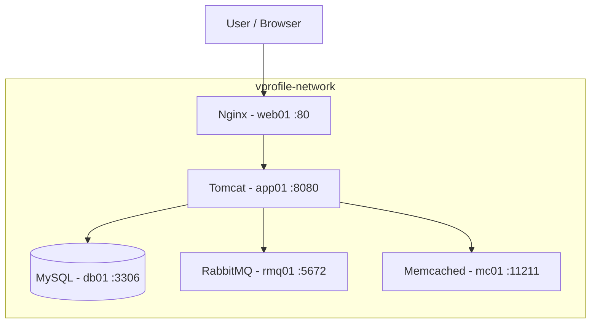

# VProfile – Containerized Multi-Tier Application

A hands-on DevOps project focused on containerizing and deploying the VProfile Java web application using Docker, Docker Compose, MySQL, Nginx, RabbitMQ, Memcached, and Harbor Private Container Registry.

## 1. Project Overview

This project demonstrates how to transform a traditional multi-tier Java application deployment into a containerized architecture.

The application is deployed using Docker Compose, with each application component running in an isolated container connected through a dedicated Docker bridge network.

The project also introduces a private container registry using Harbor, image versioning, persistent database storage, health checks, service dependencies, and container-based deployment workflows.

### Project objectives

- Containerize a Java web application using Docker.
- Build application artifacts using Maven.
- Deploy the application using Apache Tomcat.
- Integrate MySQL as the relational database.
- Deploy RabbitMQ for messaging.
- Deploy Memcached for caching.
- Configure Nginx as a reverse proxy.
- Use Docker Compose to orchestrate multiple services.
- Implement container health checks and startup dependencies.
- Use Docker volumes for persistent data.
- Secure sensitive configuration using Docker secrets.
- Build, tag, and publish application images to Harbor.
- Implement a repeatable application deployment workflow.

## 2. Architecture

The application consists of five primary services.

| Service | Technology | Responsibility |
|---|---|---|
| web01 | Nginx | Reverse proxy and external HTTP entry point |
| app01 | Apache Tomcat | Hosts the VProfile Java web application |
| db01 | MySQL 8.0.33 | Relational database |
| rmq01 | RabbitMQ | Message broker |
| mc01 | Memcached | Application caching |

### Architecture diagram



All five services communicate over the dedicated `vprofile-network` Docker bridge network.

Only Nginx exposes an application port to the host:

- Host port: `80`
- Nginx container port: `80`
- Tomcat internal port: `8080`
- MySQL internal port: `3306`
- RabbitMQ AMQP port: `5672`
- Memcached port: `11211`

The application services are not intended to be accessed directly from outside the Docker network.

## 3. Technology Stack

| Component | Technology |
|---|---|
| Application | VProfile Java web application |
| Build tool | Apache Maven |
| Build environment | Maven with Eclipse Temurin JDK |
| Runtime | Apache Tomcat 9 |
| Java runtime | Java 11 |
| Database | MySQL Community Server 8.0.33 |
| JDBC driver | MySQL Connector/J 8.0.32 |
| Web server | Nginx |
| Messaging | RabbitMQ |
| Caching | Memcached |
| Container runtime | Docker Engine |
| Orchestration | Docker Compose |
| Private registry | Harbor 2.15.5 |
| Registry access | HTTPS / TLS |

*Exact image tags should be checked against the project's Dockerfile and Compose configuration.*

## 4. Application Build and Image Management

The application is packaged as a WAR artifact using Maven.

The Dockerfile uses a multi-stage build:

1. Build stage: Maven compiles and packages the Java application.
2. Runtime stage: Tomcat hosts the generated WAR file.

The WAR is deployed as:

```text
/usr/local/tomcat/webapps/ROOT.war
```

The application image is built locally, tagged, and published to Harbor.

Example image:

```text
harbor.lab.local/devops-senior/vapp:v4
```

This separates application development and image building from runtime deployment.

## 5. Database Integration

The project uses MySQL 8.0.33.

The database configuration includes:

- Database name: `accounts`
- Database container hostname: `vprodb`
- Database port: `3306`
- Database initialization: SQL dump mounted into the MySQL initialization directory.
- Persistent storage: Named Docker volume.

The application connects through JDBC.

Example configuration:

```properties
jdbc.driverClassName=com.mysql.cj.jdbc.Driver
jdbc.url=jdbc:mysql://vprodb:3306/accounts?useUnicode=true&characterEncoding=UTF-8&zeroDateTimeBehavior=convertToNull
jdbc.username=root
jdbc.password=REPLACE_WITH_LOCAL_SECRET
```

The password shown above is a placeholder. The actual lab credential must not be committed to a public repository.

## 6. Networking

Docker Compose creates a dedicated bridge network:

```text
vprofile-network
```

Container-to-container communication uses Docker DNS and the configured service hostnames or network aliases.

The main communication paths are:

- Nginx → Tomcat
- Tomcat → MySQL
- Tomcat → RabbitMQ
- Tomcat → Memcached

The MySQL hostname `vprodb` must resolve from the application container.

## 7. Persistent Storage

Named Docker volumes are used for stateful services.

| Service | Persistent data |
|---|---|
| MySQL | Database files |
| RabbitMQ | Broker data |

Application image updates do not require deleting database volumes.

The SQL initialization script is executed by the MySQL image only when initializing an empty data directory. Recreating the container with an existing database volume does not automatically re-import the SQL dump.

## 8. Security Considerations

The project incorporates several security practices:

- Harbor registry accessed through HTTPS.
- TLS certificate configured for the private registry.
- Sensitive database credentials supplied using Docker secrets.
- Internal application services isolated on a private Docker network.
- Only Nginx exposes the application HTTP endpoint.
- Versioned application image tags used for deployment and rollback.

For production environments, the application should use a dedicated database account with restricted privileges rather than the MySQL root account.

Never commit private keys, passwords, or secret files to GitHub.

## 9. Project Directory Structure

Example logical project layout:

```text
vprofile-project/
│
├── Dockerfile
├── docker-compose.yml
├── .env
├── .env.example
├── .dockerignore
├── .gitignore
│
├── database/
│   └── init/
│       └── db_backup.sql
│
├── secrets/
│   ├── mysql_root_password.txt
│   └── rabbitmq_password.txt
│
├── nginx/
│   └── default.conf
│
├── src/
└──pom.xml
```

The actual directory names should match the checked-in project files. Do not commit the contents of the `secrets/` directory or generated build artifacts unless intentionally required.

## 10. Deployment Overview

The high-level deployment workflow:

```text
Application Source Code
          |
          v
      Maven Build
          |
          v
       WAR File
          |
          v
      Docker Build
          |
          v
    Versioned Image
          |
          v
    Harbor Registry
          |
          v
     Docker Compose
          |
          v
  Multi-Tier Application
```

Detailed installation and deployment instructions are documented in [INSTALLATION.md](INSTALLATION.md).

## 11. Learning Outcomes

By completing this project, the following practical skills were developed:

- Dockerfile development and multi-stage builds.
- Docker image lifecycle management.
- Docker Compose orchestration.
- Container networking and DNS.
- Database initialization and persistence.
- JDBC application connectivity.
- Docker secrets management.
- Health checks and service dependencies.
- Harbor registry installation and TLS configuration.
- Private image publishing and retrieval.
- Application deployment and troubleshooting.

## 12. Future Improvements

Potential extensions include:

- Introduce CI/CD using Jenkins or GitHub Actions.
- Add Prometheus and Grafana monitoring.
- Implement centralized logging.
- Introduce container resource limits.
- Add automated database backups.
- Implement a dedicated non-root database user.
- Deploy the architecture to AWS using Terraform.
- Migrate the application to Kubernetes.

---

**Project:** VProfile Containerized Multi-Tier Application

**Focus:** Docker, Docker Compose, MySQL, Harbor, Nginx, and DevOps practices.