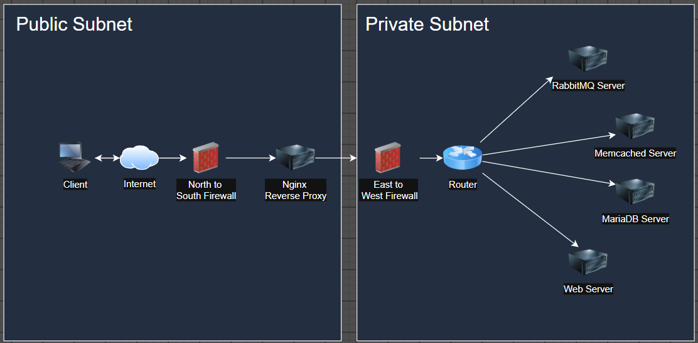
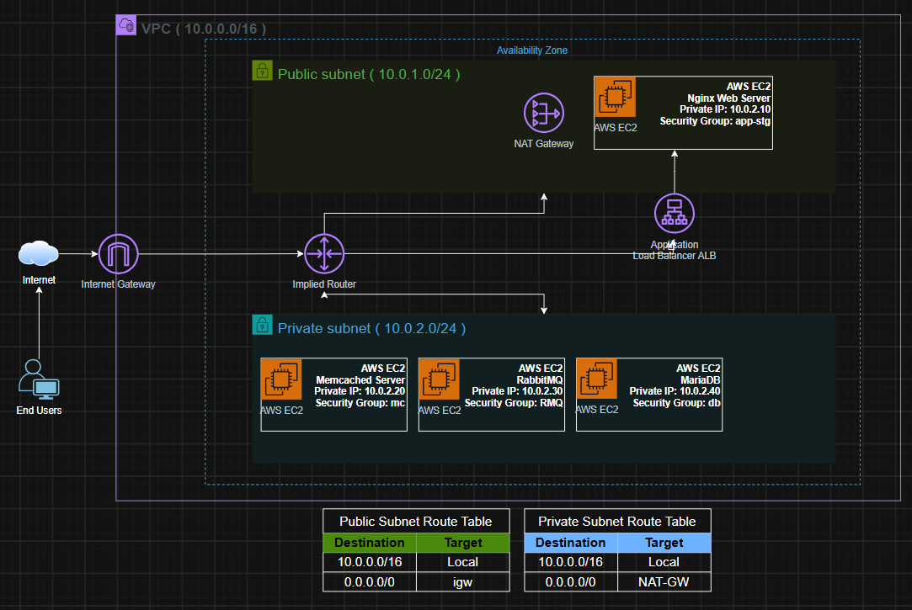

NOTE: before deploying anything on cloud you must know how to deploy it on prem and then convert all on prem resources to a cloud resources.

as per understanding to the current project, we need to deploy application from on prem to AWS cloud provider.

let's see how the architecture is on prem first.

## On prem architecture is

let's convert the architecture from on prem to cloud resources

let's design the netwoek traffic flow to check what you need on cloud

## Onprem Network Diagram

## AWS Network Diagram

let use the onprem diagram and design the AWS Cloud diagram

Onprem Resources >>> AWS Cloud Resources
Datacenter >>> VPC
Datacenter Geographic Location >>> Availability Zone
Intenet Firewall >>> IGW
Reverse Proxy >>> ALB
Nginx Web Server >>> Nginx EC2
MariaDB Server >>> MariaDB EC2
Mecached Server >>> Memcached EC2
RabbitMQ Server >>> RabbitMQ Server
Public DMZ >>> Public Subnet
Private DMZ >>> Private Subent
Router >>> Implied Router
Public Subnet Routing Table
Private Subnet Routing Table

Phase 1 – Terraform and AWS preparation
Start here
- Install Terraform on Windows.
- Install and configure AWS CLI.
- Configure AWS credentials securely.
- Understand Terraform providers, variables, outputs and state.

Phase 2 – AWS networking
- Create VPC.
- Create six subnets across two AZs.
- Create Internet Gateway.
- Create NAT Gateway.
- Create public/private route tables.
- Associate route tables with subnets.

Phase 3 – Network security
- Create Security Groups.
- Define ALB security rules.
- Define NGINX security rules.
- Define application security rules.
- Define database and messaging security rules.

Phase 4 – Load balancing and web tier
- Deploy NGINX EC2 instances.
- Create Application Load Balancer.
- Create target groups.
- Configure listeners and health checks.
- Configure HTTPS with ACM.

Phase 5 – Application tier
- Deploy two application EC2 instances.
- Configure Java and Tomcat.
- Configure application deployment.
- Connect NGINX to application servers.

Phase 6 – Backend services
- Deploy MariaDB.
- Deploy RabbitMQ.
- Deploy Memcached.
- Configure EFS shared storage.
- Configure application connectivity.

Phase 7 – Validation and troubleshooting
- Test DNS resolution.
- Test security group restrictions.
- Test application connectivity.
- Test ALB health checks.
- Simulate instance failures.

Phase 8 – Production improvements
- Auto Scaling Groups.
- RDS and ElastiCache migration.
- Multi-AZ database architecture.
- CloudWatch monitoring.
- Terraform remote state with S3 and locking.
- Backup and disaster recovery.

